# Ejercicios de Pilas en Java

**Alumno:** Luis Fernando Campuzano Hernández

**Grupo:** GTID244

**Materia:** Estructura de Datos

---

## Descripción

En este repositorio se encuentran las soluciones de los ejercicios pares de la actividad de Estructuras de Datos, desarrollados en Java.

El objetivo es practicar el uso de la estructura de datos **Pila (Stack)**, aplicando el principio LIFO (*Last In, First Out*), donde el último elemento en entrar es el primero en salir.

Cada ejercicio incluye su código fuente y las evidencias de las pruebas realizadas en CMD y omegaUp.

---

## Ejercicio 2 — 4086. Conjunto

Validación de cadenas mediante el balance de paréntesis y la comprobación de caracteres permitidos.

### Evidencias

**1. Ejecución del programa en CMD**

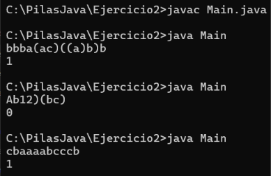

**2. Código fuente enviado a omegaUp**

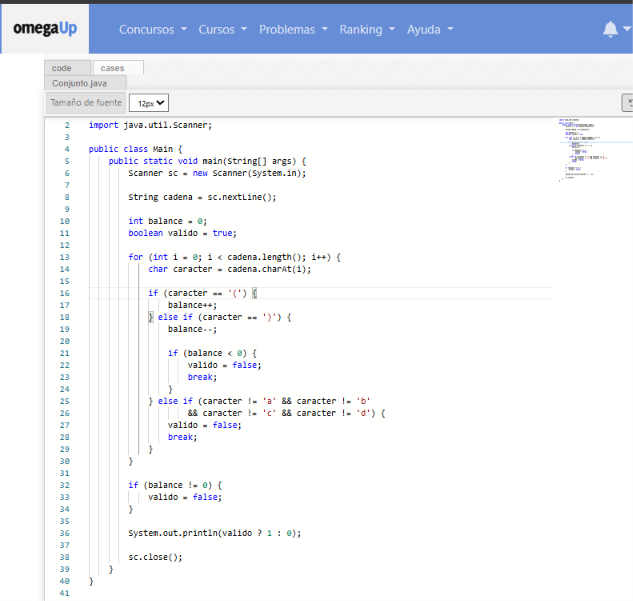

**3. Resultado de aceptación en omegaUp**

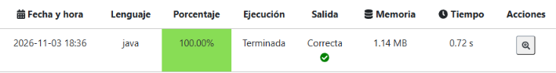

---

## Ejercicio 4 — 5308. Paréntesis Extravagantes

Uso de una pila para determinar los cambios necesarios para equilibrar correctamente una secuencia de paréntesis.

### Evidencias

**1. Ejecución del programa en CMD**

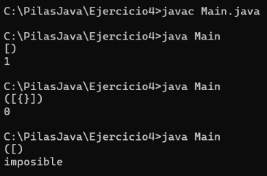

**2. Código fuente enviado a omegaUp**

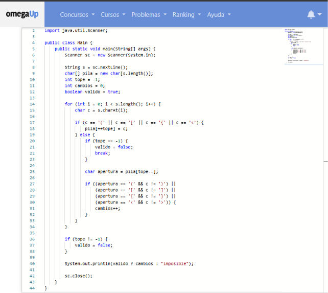

**3. Resultado de aceptación en omegaUp**

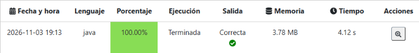

---

## Ejercicio 6 — 6818. Los Últimos Serán Los Primeros

Implementación de una pila para almacenar elementos y mostrarlos en orden inverso al que fueron ingresados.

### Evidencias

**1. Ejecución del programa en CMD**

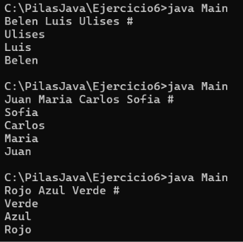

**2. Código fuente enviado a omegaUp**

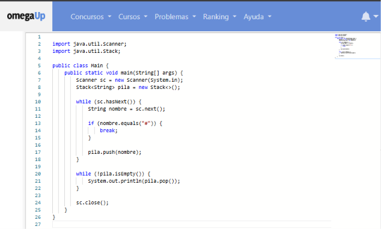

**3. Resultado de aceptación en omegaUp**

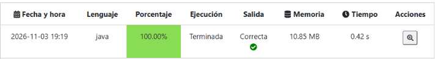

---

## Ejercicio 8 — 1019. Operaciones con una pila

Práctica de operaciones de almacenamiento y extracción de elementos utilizando una estructura de pila.

### Evidencias

**1. Ejecución del programa en CMD**

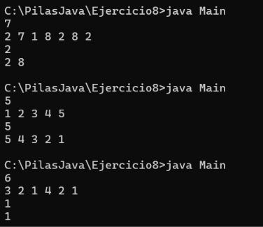

**2. Código fuente enviado a omegaUp**

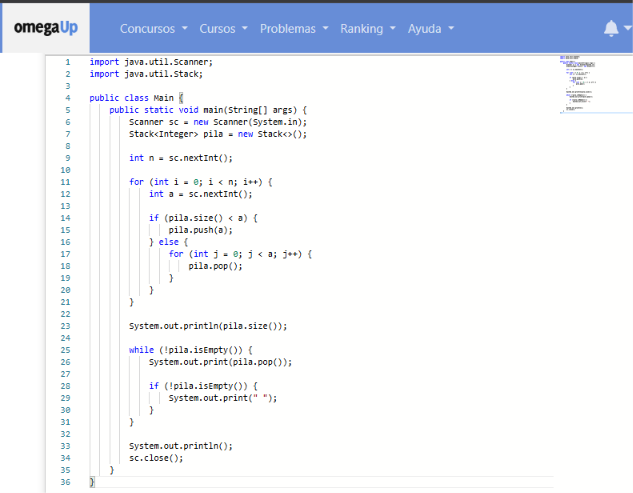

**3. Resultado de aceptación en omegaUp**

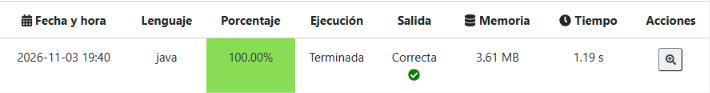

---

## Ejercicio 10 — 3878. Paréntesis Regulares

Uso de una pila para encontrar la subcadena contigua más larga de paréntesis correctamente balanceados y contar cuántas veces aparece esa longitud máxima.

### Evidencias

**1. Ejecución del programa en CMD**

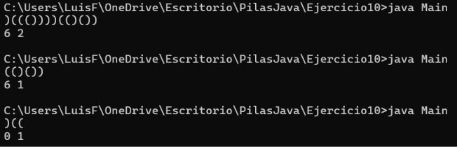

**2. Código fuente enviado a omegaUp**

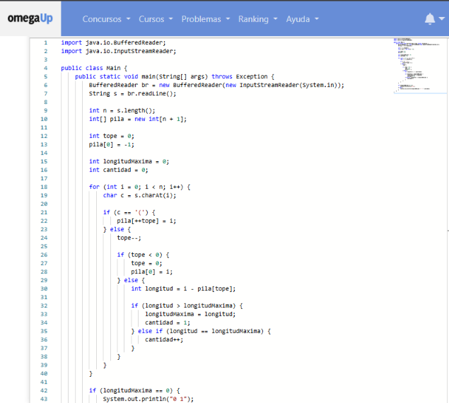

**3. Resultado de aceptación en omegaUp**

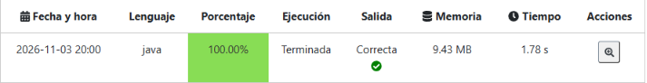

---

## Ejercicio 12 — 8672. Sumando con pilas

Implementación de una pila para agregar números, consumir los dos elementos superiores y almacenar su suma, además de imprimir el elemento que se encuentra en la cima.

### Evidencias

**1. Ejecución del programa en CMD**

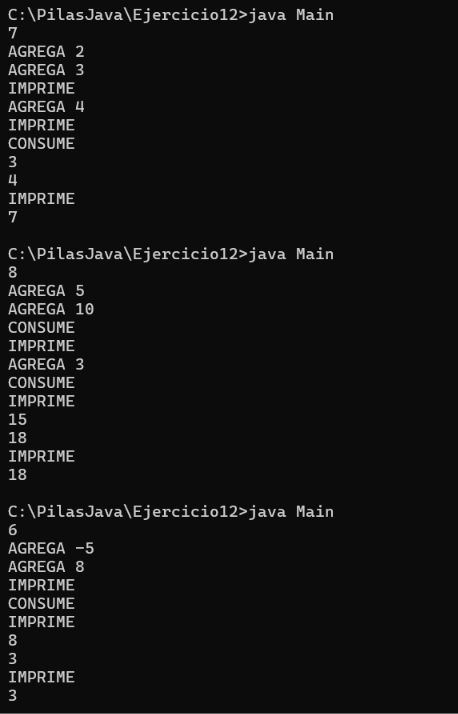

**2. Código fuente enviado a omegaUp**

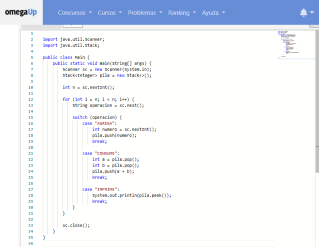

**3. Resultado de aceptación en omegaUp**

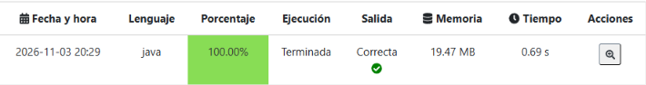

---

## Tecnologías utilizadas

- Java
- Estructura de datos Stack (Pila)
- CMD de Windows
- omegaUp
- Git
- GitHub

---

## Conclusión

Con la realización de estos ejercicios se reforzó el conocimiento sobre el funcionamiento de las pilas y el principio LIFO, aplicándolo en diferentes problemas mediante Java.

También se practicó la compilación y ejecución de programas, la realización de pruebas, la validación de resultados en omegaUp y el control de versiones mediante Git y GitHub.
